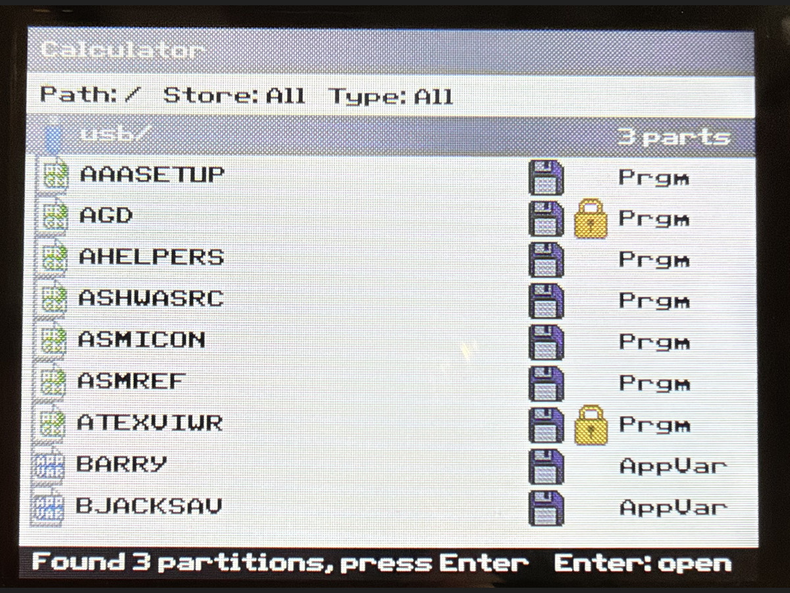
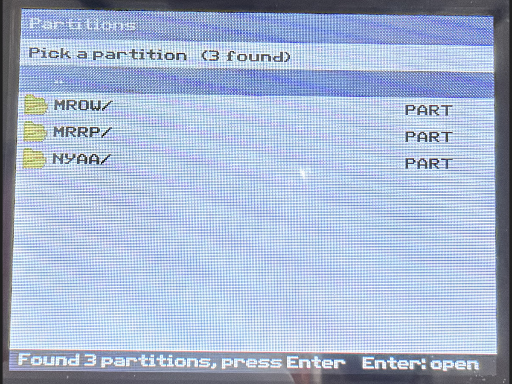
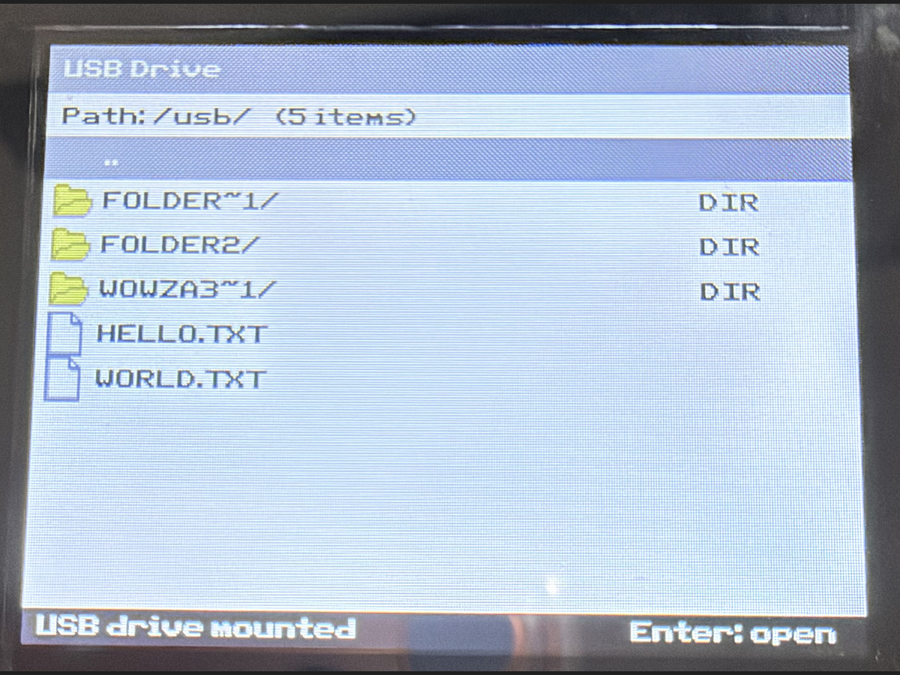

# FileR

File manager for the TI-84 Plus CE (or similar) with USB support!

### Status

Currently in development.

## Current capabilities & checklist

- [x] Read files
- [ ] Write to files
- [x] List files
- [x] Filter through files
- [x] Nice(ish) UI
- [x] Battery display
- [x] Charging handling(ish)
- [x] Icon support (is still a little bit wonky & has wrong colours)
- [x] USB support
- [x] USB partition support
- [x] USB partition names
- [ ] Copy from USB to calculator

### Current limitations

- Can't edit/write
- Can't copy programs to the calculator
- Since `fileioc.h` doesn't expose apps, I can't add them into the filter list

### Supported Filetypes

These are the currently supported filetypes (to open)

- `.txt`
- `.html`
- `.htm`
- `.bmp` (uncompressed)

### Filter meanings

| Filter | Meaning |
|---|---|
| `Type` | Type of variable (Program, AppVar, etc.) |
| `Store` | Where the file is stored (Archive / RAM) |

## Usage / Keybinds

| Key | Action |
|---|---|
| Up | Move selection up (Move up 10 (Alpha)) |
| Down | Move selection down (Move down 10 (Alpha))|
| Left | Cycle left `Type` filter |
| Right | Cycle right `Type` filter |
| 2nd | Toggle Shift |
| Alpha | Toggle Alpha / Alpha Lock (Shift) |
| Y = | Search |
| Graph | Cycle `Store` filter |
| Enter | Enter actions |
| Clear | Clear actions |
| Del | Exit FileR |

Clear actions are as follows

| Context | Action |
|---|---|
| In search | Clear the search |
| In USB directories | Go down a directory |
| In calculator "root" | Exit FileR |

Enter actions are as follows

| Context | Action |
|---|---|
| On a calculator variable | Shows info about the variable / Closes variable info |
| On a `.txt` or `.html` file | Opens with the text viewer / Closes text viewer |
| On a `.bmp` file | Opens with image viewer / Closes image viewer |

### How to format a USB device for the calculator

> [!CAUTION]
> **BACKUP DATA ON SAID USB DEVICE, AS THIS *CAN* & MOST LIKELY *WILL* REMOVE <u>ALL</u> DATA ON SAID USB DEVICE**

Please note that this only works with drives of **32 GB or less**

#### Windows (11/10)

1. Go to your search bar & search up "*Create and*", Windows *should* auto-complete it to "*Create and format hard disk partitions*", when that is shown, open it.
2. In the bottom half of the *Create and format hard disk partitions* window, locate the USB to format & right-click its respective box on the left.
  - Check the menu
    1. If it says "*Convert to GPT Disk*", move to #3
    2. If it says "*Convert to MBR Disk*", select it. This will change your USB from GPT to MBR. (This is the part that wipes the USB)
      <sub>If this option is grayed out, delete all partitions on the USB, then try again.</sub>
3. Right-click the unallocated space & select "*New Simple Volume*".
4. Follow the wizard prompts until you reach the "*Format Partition*" window.
5. Change the *File system* dropdown to FAT32.
6. Check the box "*Perform a quick format*".
7. Select *Next*, then *Finish*.

#### Linux

This varies by distro, so if yours isn't mentioned, check for your equivalent online, although it should more or less resemble this tutorial

1. Install GParted.
  - Debian based
```bash
sudo apt update && sudo apt install gparted
```
  - Arch based
```bash
sudo pacman -S gparted
```
  - Red Hat Enterprise Linux / Fedora based
```bash
sudo dnf install gparted
```
2. Open GParted & select the USB to format in the top-left dropdown. (`/dev/sdX`)
  <sub>If needed, refresh GParted with `Ctrl+R`</sub>
3. Select "*Device Information*" under "*View*" in the menu bar.
  - Check "*Partition table*"
    1. If it says "*msdos*" or "*MBR*", then continue to #6
    2. If it doesn't say "*msdos*" or "*MBR*", then continue to #4
4. Unmount all partitions.
5. Select "*Create Partition Table...*" under "*Device*" and set the *Partition Table Type* dropdown to "*msdos*" or "*MBR*" (This is the part that wipes the USB)
6. After the operation finishes, right-click the unallocated space & select "*New*"
7. Change *File system* to FAT32.
8. Edit other settings to your liking.
9. Select "*Add*" & confirm the operation.

#### macOS

sorry i don't use macOS, i can't help you here, just check a tutorial online :C

## Screenshots







